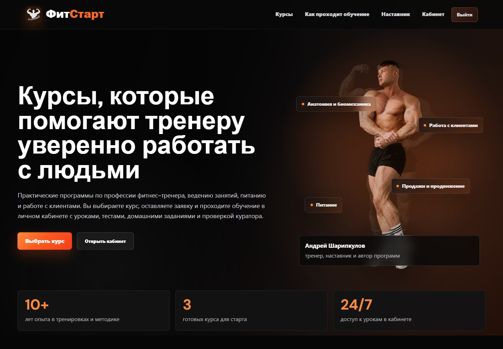

# ФитСтарт

Платформа онлайн-курсов для фитнес-тренеров на React, PHP и MySQL. Каталог, кабинет ученика, модули и уроки, видео, практические задания, тесты и прогресс обучения. Администратор управляет курсами и заявками, куратор проверяет работы в пределах назначенных прав.

[Открыть сайт с курсами](https://valkohappy.github.io/fitstart-learning-platform/)



## Версия на GitHub Pages

Доступны три примера курсов с двенадцатью уроками. Можно читать материалы, открывать видео, отправлять ответы и проходить тесты. Первое открытие входит в локальный профиль ученика. После выхода можно войти с логином demo_student и паролем FitStartDemo1! либо создать отдельный профиль в этом браузере.

Pages работает без PHP. Профили, ответы и прогресс сохраняются только в браузере; очистка данных сайта удаляет их. Учётные записи не связаны с серверной базой. Почта, загрузка файлов на сервер и проверка работ куратором доступны в полной версии. Внешние видео загружаются с Rutube и зависят от доступности провайдера. Учебное содержимое в примерах сокращено для демонстрации интерфейса.

## Полная версия

Требуются Node.js 22.12+, PHP 8.3+ с pdo_mysql, mbstring, fileinfo и MySQL 8. Для оптимизации изображений нужен GD, для SMTP через TLS — OpenSSL.

1. Создайте пустую базу MySQL и отдельного пользователя с доступом к ней.
2. Скопируйте .env.example в .env и укажите параметры базы.
3. Выполните команды из корня проекта.

```sh
php bin/install.php
php bin/seed-demo.php
npm --prefix frontend ci
php -S 127.0.0.1:8010 -t public public/router.php
```

В другом терминале запустите интерфейс.

```sh
npm --prefix frontend run dev -- --host 127.0.0.1 --port 5173
```

Откройте http://127.0.0.1:5173. Значение FRONTEND_ORIGIN должно совпадать с адресом интерфейса. Vite перенаправляет API и изображения на PHP-сервер. При другом адресе API задайте VITE_API_TARGET. VITE_API_URL меняет путь API в клиенте.

Администратор создаётся командой php bin/create-admin.php после задания ADMIN_LOGIN, ADMIN_EMAIL и ADMIN_PASSWORD в окружении. Пароль должен содержать не меньше 12 символов; после создания удалите его из окружения. Предустановленного серверного администратора нет.

Для сборки демонстрационной версии задайте VITE_DEMO_MODE=true и VITE_BASE_PATH=/fitstart-learning-platform/, затем выполните npm --prefix frontend run build. Обычная сборка без этих переменных работает с PHP API. Для публикации полной версии нужны веб-сервер с PHP, MySQL, HTTPS и отдельная эксплуатационная настройка, включая ограничение частоты входа и восстановления пароля.

## Структура

| Каталог | Ответственность |
| --- | --- |
| frontend/src/Pages | Страницы и координация пользовательских сценариев |
| frontend/src/features/course-builder | Метаданные курса, структура, редактор уроков и тестов, перемещение элементов |
| frontend/src/features/learning | Навигация по урокам и отображение материалов |
| frontend/src/services | HTTP-клиент и CSRF |
| frontend/src/lib | Правила обучения, подготовка данных и общие функции |
| frontend/src/demo | Локальное хранилище и адаптер демонстрационных данных |
| src/Http | Маршрутизация и защита сессии |
| src/controllers | Обработка действий API |
| src/models | Операции с курсами, пользователями, заданиями и заявками |
| src/infrastructure/database | Подключение операций к PDO |
| src/services | Хранение и обработка обложек курсов |
| database | Структура базы и примеры курсов без пользовательских данных |

Сервер проверяет роли и права на операции. Изменяющие запросы используют POST и CSRF-токен. Пароли хешируются на сервере, идентификатор сессии обновляется при входе. Обложки проверяются по типу содержимого и размеру.

## Проверки

```sh
npm --prefix frontend run lint
npm --prefix frontend run test:learning
npm --prefix frontend run build
node tests/api.mjs
```

API-тесты требуют отдельную базу с именем, заканчивающимся на _test, установленную схему, примеры курсов и запущенный PHP-сервер на 127.0.0.1:8018. Можно изменить адрес через API_TEST_URL. PHP_BIN и PHP_ARGS позволяют выбрать PHP и аргументы его запуска. Тесты создают только собственные учётные записи и проверяют доступы, CSRF, регистрацию, вход, редактор курсов, одобрение заявок, задания и тесты. CI запускает их на MySQL 8.

Исходная рабочая база, аккаунты, файлы учеников, настройки доступа и локальные материалы в репозиторий не входят.
