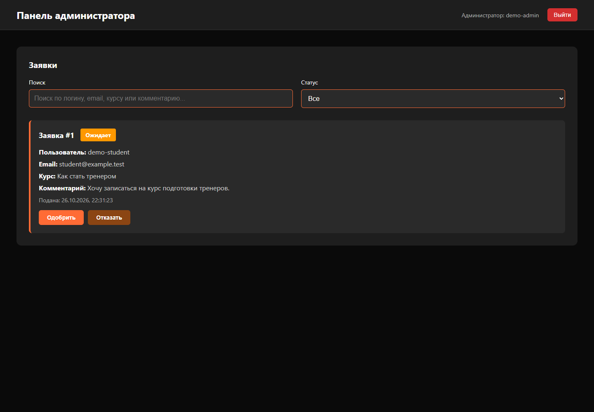

# Запись на курсы

Учебное fullstack-приложение на React и PHP. Пользователь регистрируется, входит в кабинет и подаёт заявку на курс. Администратор просматривает заявки, ищет их по тексту и меняет статус.



## Стек и устройство

React 18, React Router, Vite, PHP 8.2+ и MySQL 8.

| Каталог | Назначение |
| --- | --- |
| frontend/src/pages | Формы входа, регистрации, кабинет и панель администратора |
| frontend/src/services | Общий HTTP-клиент, работа с сессией и API заявок |
| backend/src/Domain | Ошибки предметных операций |
| backend/src/Application | Сценарии регистрации, входа и работы с заявками, интерфейсы хранилищ |
| backend/src/Infrastructure | Подключение PDO и реализации репозиториев |
| backend/src/Http | Проверка запросов, сессии, CSRF, контроллеры и JSON-ответы |
| backend/api | Сборка зависимостей и точки входа API |
| database | Структура MySQL без пользовательских данных |
| tests | Интеграционные проверки HTTP API |

Пароли хешируются на сервере. Роль пользователя определяется сервером. Обычный пользователь видит свои заявки, администратор видит все. Изменяющие запросы требуют CSRF-токен. Ограничение базы исключает две ожидающие заявки одного пользователя.

## Запуск

Установите Node.js 22.12+, PHP 8.2+ с pdo_mysql и MySQL 8. Скопируйте .env.example в .env, укажите доступ к собственной базе. Импортируйте database/init.sql в MySQL, затем запустите API из корня проекта.

```sh
php -S 127.0.0.1:8081 backend/router.php
```

Во втором терминале запустите интерфейс.

```sh
npm --prefix frontend ci
npm --prefix frontend run dev
```

Откройте http://127.0.0.1:3000. Vite перенаправляет /api в локальный PHP-сервер. Стандартного администратора нет. Для создания своего задайте переменные окружения ADMIN_LOGIN, ADMIN_EMAIL и ADMIN_PASSWORD, затем выполните php backend/bin/create-admin.php и удалите пароль из окружения.

Переменная VITE_API_URL позволяет задать другой адрес API при сборке. Сервер принимает междоменные запросы только от FRONTEND_ORIGIN.

## Проверки

```sh
npm --prefix frontend run build
node tests/api.mjs
```

Для локального прогона API нужен pdo_sqlite: тесты поднимают отдельный PHP-процесс и временную базу. В CI тот же набор выполняется на MySQL 8 в отдельной тестовой базе. Проверяются вход, регистрация, CSRF, разграничение доступа, фильтры, статусы, повторные заявки и некорректные запросы.

Это учебный проект. Внешняя почта, платежи и интеграции с образовательными платформами не подключены. Для публичного размещения дополнительно нужны HTTPS, ограничение частоты запросов и эксплуатационная настройка сервера. GitHub Pages не выполняет PHP.
